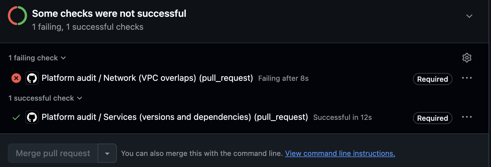

# GitHub Action

```yaml
- uses: JayKearney/infradoctor@v1
  with:
    args: network check terraform/ --known terraform/known-ranges.txt
    fail-on: error
```

| Input | Default | Description |
|---|---|---|
| `args` | (required) | Arguments for infradoctor |
| `fail-on` | `error` | Fail on `error`, or also on `warning` |
| `python-version` | `3.12` | Python version used to run infradoctor |

Findings appear as annotations on the changed lines, and the full report is added to the job summary.
With the check required on the main branch, a pull request can't be merged until it passes:

