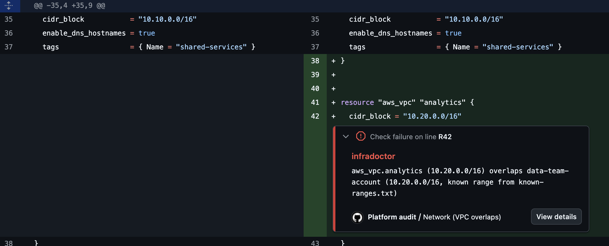

# infradoctor

infradoctor checks infrastructure changes on the pull request, before they're merged. It reads the files
platform teams already have (Terraform, service inventories, access logs, artifact folders) and reports
what needs fixing. It runs as a CLI or as a GitHub Action.



## Quick start

```bash
pip install git+https://github.com/JayKearney/infradoctor.git
infradoctor network check terraform/
```

## Links

- [GitHub Marketplace](https://github.com/marketplace/actions/infradoctor)
- [Changelog](https://github.com/JayKearney/infradoctor/blob/main/CHANGELOG.md)
- [Example repo using it on every pull request](https://github.com/JayKearney/platform-config)